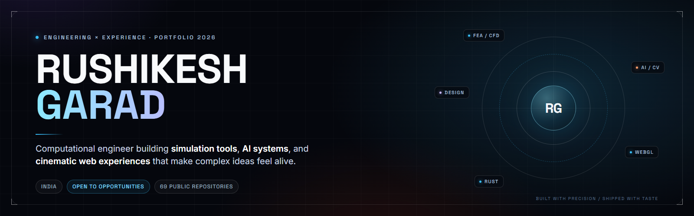
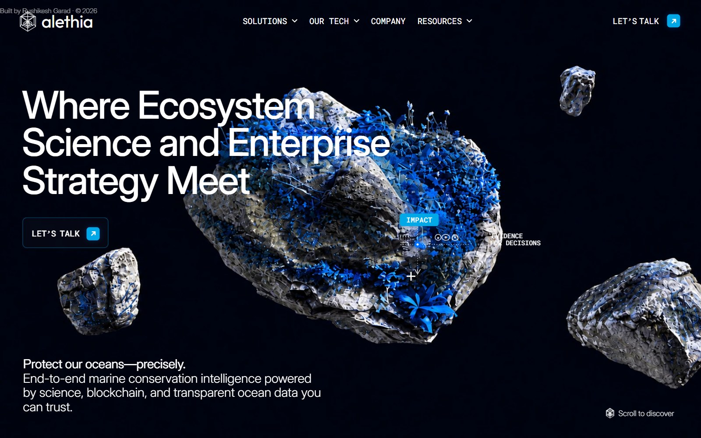



  

<h3 align="center">Computational engineer · AI builder · creative developer</h3>

  I build <b>simulation tools</b>, <b>AI systems</b>, and <b>cinematic web experiences</b> — work that turns complex engineering into something people can see, feel, and use.

  
  
  
  

  📍 India &nbsp;·&nbsp; 🟢 Available for select collaborations &nbsp;·&nbsp; 60+ public repositories

---

## 🎬 Live experiences

Scroll-driven sites built like films — a strong opening, a clear arc, and a reason to keep moving.

<table>
  <tr>
    <td width="62%" valign="top">
      
    </td>
    <td width="38%" valign="top">
      <h3>Mostar City</h3>
      
<b>A three-act cinematic scroll through Bosnia's Old Bridge city.</b>

      
Layered scenes, pointer parallax, and scroll-linked transitions turn a travel landing page into a slow crossing.

      

        <code>HTML</code> <code>CSS</code> <code>Vanilla JS</code> <code>Zero build</code>
      

      

        <a href="https://rushikeshgarad2024-dev.github.io/mostar-city/"><b>Open live site →</b></a> 
        <a href="https://github.com/rushikeshgarad2024-dev/mostar-city">View source</a>
      

    </td>
  </tr>
</table>

<table>
  <tr>
    <td width="50%" valign="top">
      
      <h3>HiJOY — Dream Garden</h3>
      
A surreal botanical fashion campaign where layered florals, eye motifs, and scroll-triggered chapters unfold like a dream.

      
<code>Editorial</code> <code>Scroll film</code> <code>Motion</code>

      

        <a href="https://rushikeshgarad2024-dev.github.io/dream-garden-landing/"><b>Live →</b></a> &nbsp;·&nbsp;
        <a href="https://github.com/rushikeshgarad2024-dev/dream-garden-landing">Source</a>
      

    </td>
    <td width="50%" valign="top">
      
      <h3>Alethia — Ocean Intelligence</h3>
      
A cinematic climate-tech experience re-themed for ocean conservation, pairing deep-sea visuals with science-backed data storytelling.

      
<code>Data story</code> <code>Brand</code> <code>Immersive</code>

      

        <a href="https://rushikeshgarad2024-dev.github.io/alethia-landing/"><b>Live →</b></a> &nbsp;·&nbsp;
        <a href="https://github.com/rushikeshgarad2024-dev/alethia-landing">Source</a>
      

    </td>
  </tr>
</table>

  <a href="https://rushikeshgarad2024-dev.github.io/web-showcase/"><b>→ Explore the full live portfolio</b></a>

---

## 🔬 Engineering systems

Simulation suites, inspection pipelines, and generative design tools — engineered for real decisions, not just demos.

| Project | Engineering highlight | Stack |
| :--- | :--- | :--- |
| 🪄 **[LLM CAD Copilot Engine](https://github.com/rushikeshgarad2024-dev/llm-cad-copilot-engine)** | Natural language → parametric 3D models with an OpenSCAD generation pipeline and live Three.js preview. | `Python` `OpenSCAD` `Three.js` |
| 🔍 **[AI Defect Inspection Suite](https://github.com/rushikeshgarad2024-dev/ai-computer-vision-defect-detection)** | Automated optical inspection for weld cracks, voids, and PCB bridges — under 15 ms per frame. | `PyTorch` `Computer Vision` |
| 🧬 **[Generative Topology Optimization](https://github.com/rushikeshgarad2024-dev/generative-cad-topology-optimization)** | SIMP compliance minimization for lightweight aerospace parts — up to 60% mass reduction. | `FEA` `SIMP` `Python` |
| 🔋 **[EV Battery Thermal Management](https://github.com/rushikeshgarad2024-dev/ev-battery-thermal-management-system)** | Lumped-capacitance thermal model with Joule heating, cold-plate heat flux, and SOH-aware pack analysis. | `BTMS` `Thermal` `Python` |
| 🦾 **[Robotics Kinematics Studio](https://github.com/rushikeshgarad2024-dev/robotics-kinematics-studio)** | 3-DOF / 6-DOF forward and inverse kinematics with Denavit–Hartenberg transforms and live visualization. | `Robotics` `FK/IK` `WebGL` |
| 🚗 **[Autonomous Path Planner](https://github.com/rushikeshgarad2024-dev/autonomous-vehicle-path-planner)** | RRT* and Hybrid A* path planning with dynamic obstacle avoidance for AMRs and self-driving. | `RRT*` `A*` `Python` |

<b>More engineering systems →</b>

 

| Project | Engineering highlight | Stack |
| :--- | :--- | :--- |
| 📐 **[CAD & FEA Structural Stress Analyzer](https://github.com/rushikeshgarad2024-dev/cad-fea-stress-analyzer)** | Direct stiffness solver `[K]{U} = {F}`, Von Mises yield checks, and real-time factor-of-safety heatmaps. | `FEA` `Python` |
| 🌊 **[Thermo-Fluid & CFD Simulator](https://github.com/rushikeshgarad2024-dev/thermo-fluid-simulator)** | 2D transient Fourier heat conduction (FDM) and Navier–Stokes streamline analysis with Reynolds-number study. | `CFD` `Thermal` |
| 🏎️ **[Automotive Aerodynamics Suite](https://github.com/rushikeshgarad2024-dev/automotive-aerodynamics-suite)** | Vehicle drag force, power dissipation, and parametric NACA 4-digit airfoil modeling. | `Aerodynamics` `JS` |
| 📊 **[Vibration & Modal Analysis Suite](https://github.com/rushikeshgarad2024-dev/vibration-modal-analysis-suite)** | MDOF eigenvalue solver `det(K − ω²M) = 0`, mode-shape visualization, and resonance damping. | `Structural` `Python` |
| 🏭 **[Smart Manufacturing IIoT Dashboard](https://github.com/rushikeshgarad2024-dev/smart-manufacturing-iiot-dashboard)** | CNC spindle vibration monitoring against ISO 10816 and overall equipment effectiveness (OEE) telemetry. | `IIoT` `Industry 4.0` |
| ⭐ **[Awesome Mechanical Engineering](https://github.com/rushikeshgarad2024-dev/awesome-mechanical-engineering-open-source)** | Curated open-source CAD, FEA, CFD, robotics, and EV simulation tools. | `Open Source` |

  <a href="https://github.com/rushikeshgarad2024-dev?tab=repositories"><b>Explore all 60+ repositories →</b></a>

---

## ⚡ What I do

<table>
  <tr>
    <td width="33%" valign="top">
      <h3>🔬 Simulate</h3>
      
FEA, CFD, modal analysis, topology optimization, and thermal systems — grounded in the physics, built into usable tools.

    </td>
    <td width="33%" valign="top">
      <h3>🤖 Automate</h3>
      
Computer vision for manufacturing, text-to-CAD generation, and AI pipelines that turn messy inputs into confident decisions.

    </td>
    <td width="33%" valign="top">
      <h3>🎬 Tell the story</h3>
      
Cinematic, scroll-driven web experiences with editorial art direction, precise motion, and performance-first front-end code.

    </td>
  </tr>
</table>

---

## 🛠️ Toolbox

---

## 📊 GitHub analytics

  
  

  

---

## 🤝 Let's build something

  Have a system to simulate — or a story to tell? I'm open to engineering collaborations, product work, and select cinematic web builds.

  <a href="mailto:rushikeshgarad2024@gmail.com"><b>rushikeshgarad2024@gmail.com</b></a>
  &nbsp;·&nbsp;
  <a href="https://rushikeshgarad2024-dev.github.io/web-showcase/"><b>Live portfolio</b></a>
  &nbsp;·&nbsp;
  <a href="https://www.linkedin.com/in/rushikesh-garad-28b7a5342"><b>LinkedIn</b></a>

  Engineering precision. Cinematic execution. &nbsp;© 2026 Rushikesh Garad

